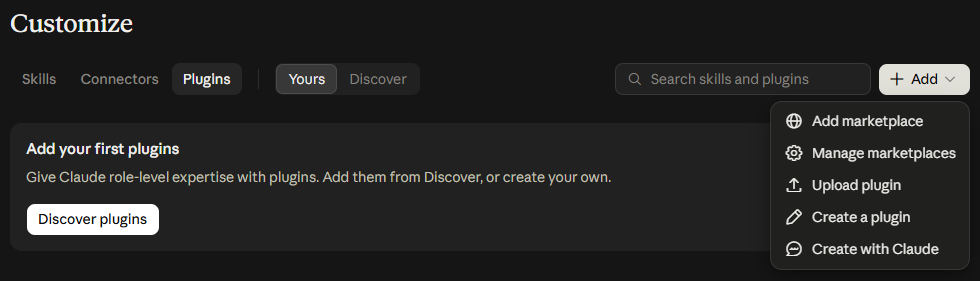
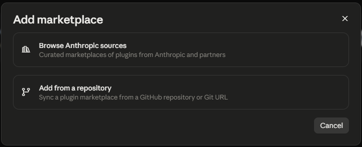
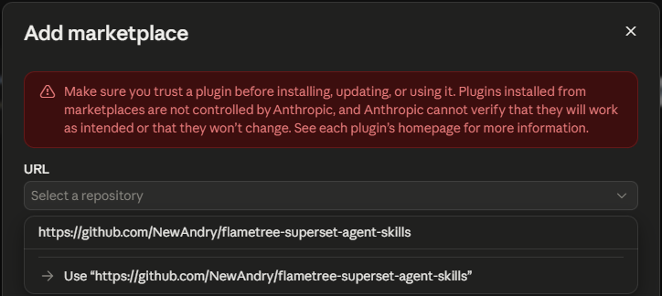
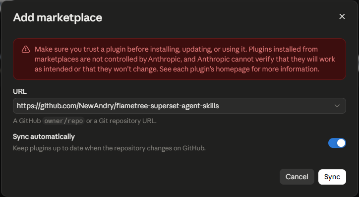
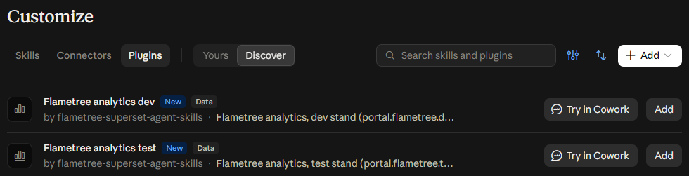
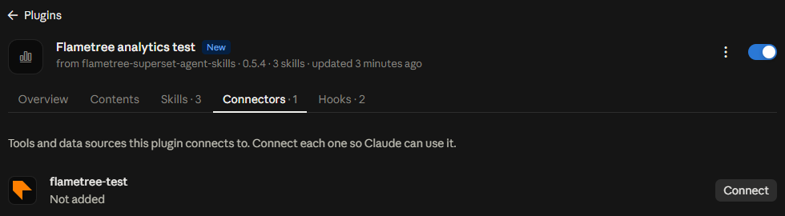
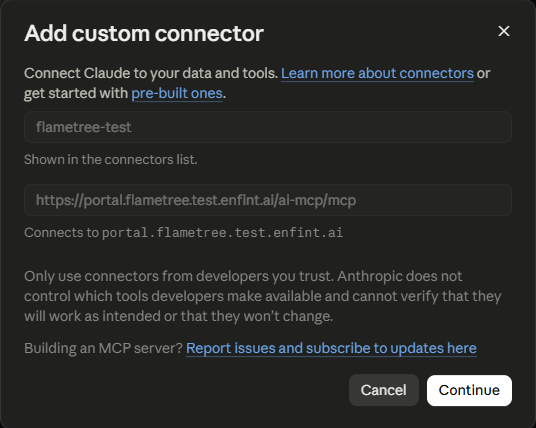
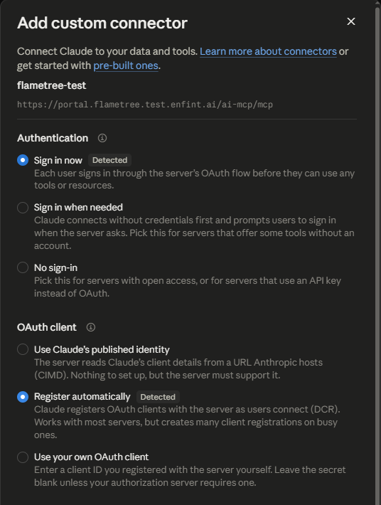
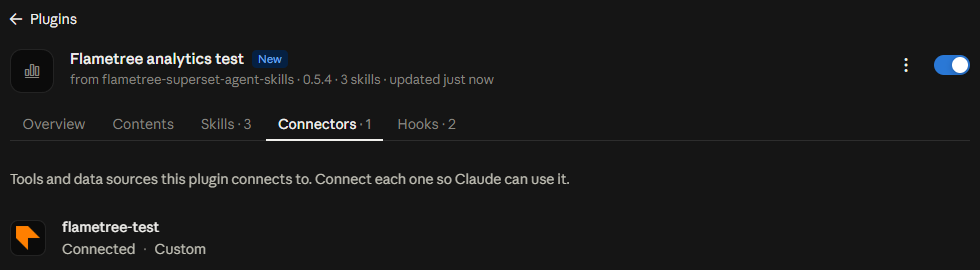

# Flametree analytics in Claude: user guide

Flametree Analytics MCP connects Claude to Flametree analytics. You describe what you need in plain words, and Claude builds charts and dashboards from your company's data, explains the numbers and publishes dashboards to the portal. Claude sees only the companies your portal account has access to, and only their data.

## What you need

- A Flametree portal account. The login and password are the same as for the portal.
- Any Claude plan for chat, including Free. On the Free plan you can connect only one custom connector, and the plugin's connector takes that slot. Claude Code works on paid plans: Pro, Max, Team or Enterprise.
- Your stand. Analytics through Claude is available on three stands now; demo will be connected later.

| Stand | Plugin | Portal |
|---|---|---|
| production | `flametree-analytics` | portal.flametree.ai |
| test | `flametree-analytics-test` | portal.flametree.test.enfint.ai |
| dev | `flametree-analytics-dev` | portal.flametree.dev.enfint.ai |

Installation takes a couple of minutes. Choose a way: Claude chat or Claude Code.

## Install in Claude chat (claude.ai or the Claude app)

1. Open **Customize** → **Plugins** → **Add** → **Add marketplace**.

   

2. Choose **Add from a repository**.

   

3. Paste `https://github.com/NewAndry/flametree-superset-agent-skills` into the field and click the **Use "…"** line under it. This is a copy of our repository on GitHub: claude.ai does not accept our GitLab address, it takes marketplaces only from github.com, gitlab.com and bitbucket.org.

   

4. Click **Sync**.

   

5. The Flametree plugins appear in the list, one per stand. Click **Add** on your stand's plugin, for example **Flametree analytics test**.

   

6. On the plugin page open the **Connectors** tab and click **Connect**.

   

7. In the first dialog change nothing and click **Continue**.

   

8. In the second dialog keep **Sign in now** and **Register automatically** selected and click **Add** at the bottom.

   

9. Sign in on the Flametree portal page. If you are already signed in to the portal in this browser, sign-in completes by itself. The connector turns **Connected**.

   

Done: in a new chat ask "show my Flametree tenants".

If claude.ai says "This marketplace is already added" or the list shows old plugins, remove the previous Flametree marketplace in **Add** → **Manage marketplaces** and add the address above again.

## Without the plugin: a custom connector

If the plugin cannot be installed, connect the Flametree server directly as a custom connector. The tools are the same, but without the plugin's hints about datamarts and dashboard styling: Claude figures out the data on its own.

1. Open **Customize** → **Connectors** → **Add** → **Add custom connector**.
2. Any name, for example `flametree-test`. Your stand's server address:
   - test: `https://portal.flametree.test.enfint.ai/ai-mcp/mcp`
   - dev: `https://portal.flametree.dev.enfint.ai/ai-mcp/mcp`
3. Click **Add**, then **Connect**. Change nothing in the dialog.
4. Sign in on the Flametree portal page.

## Install in Claude Code

If the plugin is already installed in Claude chat under the same account, you do not need to install it in Claude Code: it appears there by itself in the next new session.

1. Open Claude Code and start a new session.
2. Paste and send:

   ```text
   Install the Flametree Analytics MCP plugin from https://gitlab.enfint.ai/flametree/flametree-superset-agent-skills
   ```

   Claude asks which stand to connect to. production, test and dev are available now.
3. Claude installs the plugin and asks you to open a new session.
4. In the new session a terminal window and the Flametree portal sign-in page in the browser open by themselves. Sign in as usual. If you are already signed in to the portal in this browser, sign-in completes by itself and the window closes.
5. After the first sign-in, open one more new session. A session started before the sign-in does not pick it up. In the new session the Flametree tools are in place.

## First request

Start with the company. Ask:

```text
Show my Flametree tenants
```

Claude shows the companies available to your account and which one is active now. If there is one company, Claude works with it right away. If there are several, it asks which one to work with. You can switch at any time:

```text
Switch to the company <name>
```

All further numbers, charts and dashboards refer to the active company.

## What you can ask

**Numbers**

```text
How many sessions are there in total, and how many messages per session on average?
Which channels bring the most sessions?
What share of sessions is closed by the bot without an operator?
```

**Dashboard**

```text
Build the "Agent overview" dashboard for all time
Build a campaign dashboard for the last month: funnel, communication statuses, successful contacts
```

Claude creates the charts, assembles them into a dashboard in the house style, sends a link and asks whether to publish the dashboard to the portal. Nothing is published without your yes. On production, publishing to the portal from Claude is not enabled yet: open the dashboard by its Superset link.

**Open a dashboard**

The link leads to Superset. On the sign-in page click **Login with Flametree** and sign in as you do in the portal. It is the same account Claude uses.

**Publish to the portal**

```text
Yes, publish it to the portal
```

The dashboard appears in the Custom dashboards section of your company's portal, and Claude sends the link. Removing it is just as easy:

```text
Remove this dashboard from the portal
```

The dashboard itself stays in Superset.

**Understand the data**

```text
What does the COPILOT session type mean in this data?
Why is the dashboard empty for last week?
```

## If something goes wrong

| What you see | What to do |
|---|---|
| Claude Code: the sign-in window did not open | Run `claude mcp login plugin:flametree-analytics-test:flametree-test` in a terminal (for dev: `plugin:flametree-analytics-dev:flametree-dev`), then open a new session |
| Claude Code: signed in, but no tools | Open a new session. A session started before the sign-in does not pick it up; `/reload-plugins` does not help |
| "MCP access denied … tenant not provisioned" | Your portal account is not linked to a company with analytics. Contact the Flametree team |
| Chat: Claude does not see the Flametree tools | Check that the plugin's connector is connected and enabled in this chat |
| Claude asks you to sign in again | A sign-in lasts about a day. Chat: click Connect on the connector. Claude Code: open a new session, the sign-in window opens by itself |
| Numbers do not change after switching the company | Ask again "which company/tenant is active". If it is the wrong one, switch again |
| The browser signed in as someone else | The browser had someone else's portal session. Sign out of the portal and sign in again |

If nothing helps, send the Flametree team the text of Claude's answer or a screenshot. You do not need to send passwords or tokens; they are never shown anywhere.
